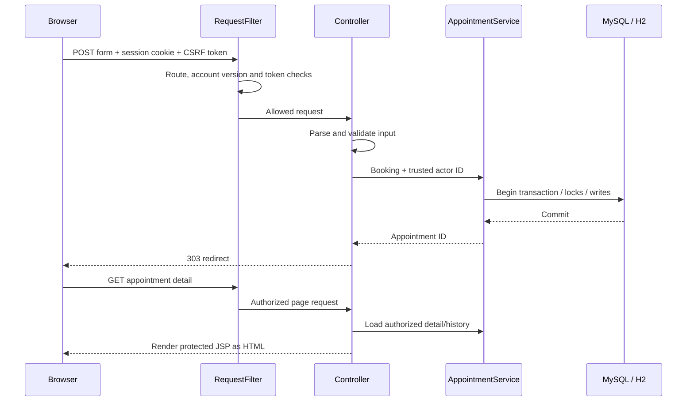
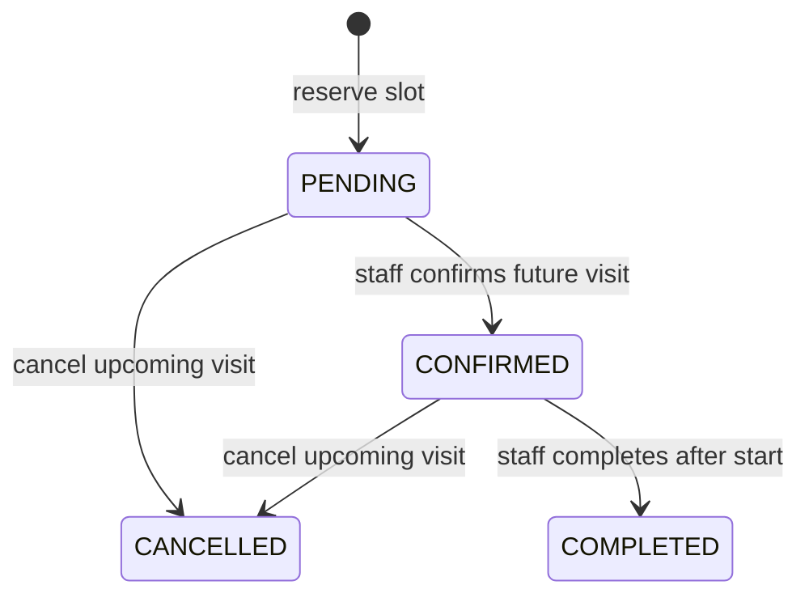

# Hospital Management System: current architecture and interview guide

This describes the improved implementation, including transactional scheduling, separate statuses and notes, services, pooled connections, database migrations, security changes, integration tests, deployment and measured performance.

The original starting repository was [lokeshmori/Hospital_Management-System-HSM](https://github.com/lokeshmori/Hospital_Management-System-HSM). Explain your work as an adaptation with demonstrated improvements, not as an application written entirely from scratch.

The numbered source appendix is [SOURCE_WALKTHROUGH.md](SOURCE_WALKTHROUGH.md). It preserves current source lines; blank lines and block-closing delimiters have no independent business behavior.

## Your 60-second interview explanation

> I improved an existing Java/JSP hospital application into a transactional appointment-scheduling system. Patients reserve published half-hour slots, doctors confirm and complete visits, and administrators manage availability and doctor accounts. I separated appointment statuses from append-only consultation notes and added activity history.
>
> The key correctness problem was concurrent booking. I use database transactions, a consistent locking order, unique slot reservations and account-scoped idempotency keys. Two simultaneous patients cannot claim the same slot, while retrying the same request returns the original appointment. Cancellation releases availability without deleting history.
>
> I also moved SQL out of JSPs, added HikariCP pooling and Flyway migrations, strengthened authentication and sessions, exposed authorized read APIs, automated tests against H2 and MySQL, and deployed the normal WAR in Tomcat. I measured a controlled count-query optimization and a limited authenticated localhost read workload.

Explain only the evidence actually collected. A configured GitHub workflow is not a completed hosted CI run, and a localhost measurement is not production capacity.

## 1. Why this approach

The application remains a server-rendered Java monolith:

- JSP/JSTL renders HTML.
- Servlet controllers handle page requests and form actions.
- Services own use cases, authorization and transaction boundaries.
- DAOs own reusable SQL and row mapping.
- The relational database enforces cross-request integrity.
- A shared filter enforces routing/session/form security and request diagnostics.

Keeping the starting Java stack avoided a framework rewrite before fixing core behavior. The educational value is that HTTP, JDBC transactions, locking, sessions and SQL constraints remain visible.

It is not Spring Boot, React, JPA/Hibernate, a microservice platform, or a distributed payment system. Adding those names to a résumé without corresponding implementation weakens the explanation.

A framework migration could later reduce manual route wiring and provide richer validation/security facilities. It is not a substitute for database-backed correctness.

## 2. Source structure

| Location | Responsibility |
| --- | --- |
| pom.xml | Java 17 target, normal WAR, dependency versions, tests, local profile |
| com/web/PageController | Load authorized page models and forward to protected views |
| com/web/ActionController | Validate form submissions, call services, establish sessions and redirect |
| com/web/ApiController | Session-authorized JSON reads |
| com/web/OperationsController | Health and admin-only metrics |
| com/service/AppointmentService | Booking, state transitions, notes, availability and audit transactions |
| com/service/HospitalService | Account/profile/specialty operations and shared application reads |
| com/service/Actor | Trusted role/account identity created from session state |
| com/dao | SQL and row mapping with closed statements/results |
| com/entity | Plain Java objects/records for accounts, slots, appointments, notes and events |
| com/security | Request policy, validation, password hashing, login throttling and escaping |
| com/db | Pooled connections, Flyway startup and explicit demo seeding |
| WEB-INF/views | Presentation-only JSP templates, inaccessible as direct public resources |
| src/main/resources/db/migration | Versioned migration history |
| src/dev/java | Opt-in embedded local runner |
| src/test/java | Unit/contracts, migration verification and a separate SQL benchmark |
| scripts | HTTP smoke/race checks and authenticated read benchmark |
| deploy, Dockerfile, compose.yaml | Reproducible Tomcat/MySQL deployment |
| .github/workflows/ci.yml | Automated build, real-MySQL and container workflow |

Small role-specific servlet classes retain the original route mappings and delegate to the common action controller. They are adapters, not separate copies of business logic.

## 3. Request execution



The browser never receives JSP Java source or a database connection. The browser session cookie identifies server-held authentication state.

A request attribute is a page model for one render. A session attribute survives several requests. A database row persists beyond the browser/server session. Controllers keep individual request values in local variables rather than mutable servlet fields.

Servlet containers can handle requests concurrently. Java-only availability checks are not sufficient across requests or across application instances.

## 4. Database design

The original tables remain user_dtls, doctor, specialist and appointment. New tables add explicit scheduling/history:

| Table | Purpose and key invariant |
| --- | --- |
| doctor_slot | A published half-hour start; unique doctor_id + starts_at |
| slot_reservation | One active reservation per slot; slot_id is its primary key |
| booking_request | Unique user_id + request_key, payload fingerprint and resulting appointment |
| appointment_note | Append-only note, author doctor and creation time |
| appointment_event | Actor, action, previous/new state and timestamp |

appointment.slot_id links a historical request to the original slot. It is nullable for pre-scheduling records.

A composite foreign key enforces that an appointment's doctor matches its slot's doctor. Another enforces that a reservation points to an appointment for that same slot.

Cancellation deletes only the active slot_reservation. It keeps appointment, notes, booking_request and event history. A later patient can reserve the released slot under a new appointment ID.

Doctor archiving sets active=false, increments its authentication version, and disables availability. It does not delete the doctor or historical clinical records. Outstanding pending/confirmed records must be resolved first.

The schema is still pragmatic rather than perfectly normalized: a doctor's specialty is a text label and patient details are stored as appointment snapshots. Contact verification, richer medical records and specialist foreign-key normalization are future work.

## 5. Concurrency-safe booking, statement by statement

Open AppointmentService.book in the numbered appendix.

1. Validate all fields, including a 16-64-character request key.
2. Hash a length-prefixed representation of the actual booking payload using SHA-256. This fingerprint is not password hashing; it detects reuse of a key for different data.
3. Borrow a pooled connection and disable auto-commit.
4. Insert booking_request with primary key (user_id, request_key). A duplicate concurrent submission waits on that database uniqueness boundary.
5. Read which doctor owns the selected slot.
6. Lock the doctor row with SELECT ... FOR UPDATE.
7. Lock the slot row. All scheduling mutations follow doctor -> slot -> appointment ordering.
8. Check that the doctor is active, slot enabled, start future, and no active reservation exists.
9. Insert appointment with PENDING status.
10. Insert slot_reservation. The unique/primary-key constraints provide a database backstop.
11. Store the resulting appointment ID on booking_request.
12. Append a BOOKED event in the same transaction.
13. Commit. On any SQL/domain failure, roll back the entire group and close the connection.

For a duplicate request-key exception, the failed transaction is rolled back. The service reads the committed original request: same fingerprint returns its appointment ID; different fingerprint returns HTTP 409.

A failed audit insert also rolls back the appointment, reservation and idempotency row. A fault-injection test proves this.

This is database-backed coordination. It does not depend on a Java synchronized block or one application instance's memory.

### Locking tradeoff

Locking the doctor row serializes short scheduling writes for a doctor. It coordinates booking, cancellation and archiving with a clear lock order, at the cost of some parallelism between different slots for that doctor.

Finer-grained locking can be worthwhile at higher write load, but would require preserving archive/availability rules and rerunning cross-operation concurrency tests. Do not claim the current design is optimized for an unlimited number of users.

## 6. State machine and clinical history



- Patients can cancel their own future open appointments.
- The assigned doctor or an administrator can confirm future pending appointments.
- Completion requires CONFIRMED and a start time that has arrived.
- CANCELLED and COMPLETED are terminal states in the current model.
- Repeating the already-applied target state is safe and does not duplicate the transition event.
- A consultation note is a separate append-only record, not a replacement status.
- Only the assigned doctor writes notes. Cancelled records reject new notes.
- Page controls show allowed actions, but services independently enforce the rules.

Legacy records without slots are explicitly labelled unscheduled. They can be cancelled; the system does not invent historical appointment times.

## 7. Service and DAO responsibilities

PageController loads page models through services and forwards to WEB-INF/views. There are no Java scriptlets or DAO calls in JSPs.

ActionController reads parameter strings, uses validation helpers, creates trusted Actor objects from sessions, and invokes use cases. Form mutations return 303 redirects on success.

AppointmentService controls transactions. AppointmentDao maps named columns and executes reusable reads. HospitalService owns account/profile/archive use cases, using the other DAOs and pooled connections.

SQL failures become DataAccessException rather than false or empty data. Expected business failures become ServiceException with an HTTP status. RequestFilter renders a safe error with a correlation ID.

Some narrow SQL operations remain inside service transaction implementations; this is a small manual-JDBC codebase, not a claim of perfect persistence abstraction. The important boundary is that views/controllers do not execute SQL and transaction ownership is explicit.

JDBC prepared statements bind values separately from SQL. setInt/setString indices start at 1. executeQuery returns rows; executeUpdate returns a write count. try-with-resources closes results, statements and connections.

Dashboard totals use database COUNT/GROUP BY aggregates. They no longer transfer every row just to increment a Java counter.

## 8. Connection pooling

DBConnect owns one application-wide HikariDataSource. DBConnect.open borrows a connection; closing the wrapper returns it to the pool.

The old ThreadLocal/DriverManager-per-request approach has been removed. Services use explicit try-with-resources ownership. Transactions roll back on SQL/domain failure before the borrowed connection is closed. The application listener closes the pool on shutdown.

Default maximum pool size is 10, with bounded connection acquisition. Increase it based on measured database/application capacity; a larger pool is not automatically faster.

The contract tests assert that operations return their borrowed connections.

## 9. Authentication and security

### Passwords

Passwords are represented as:

```text
pbkdf2$600000$base64-salt$base64-derived-key
```

Each hash has a fresh 16-byte salt and a 256-bit derived key. Verification reuses the stored salt/work factor and compares derived bytes; it does not decrypt the password. Base64 is encoding, not encryption.

Successful login upgrades supported older work factors to 600,000 using a conditional update, without resetting the account identity. Original plaintext database passwords remain unsupported.

The configured administrator uses ADMIN_PASSWORD_HASH outside demo mode. The interactive helper requires at least 12 characters and prints the hash, not the password. Demo fallback credentials exist only in explicit demo mode.

### Sessions

Login rotates the session ID and clears other role markers. Session account objects omit password hashes.

Patient and doctor tables have auth_version. The filter validates that the stored session version still matches the database. Password changes increment it and invalidate the current session; older sessions fail their next request. Archiving a doctor also revokes its sessions.

Cookies use HttpOnly and SameSite=Lax. SECURE_COOKIES requires HTTPS for the cookie when enabled. TLS termination and trusted proxy configuration are deployment responsibilities; POST itself does not provide encryption.

### Authorization and forms

Unlisted dynamic routes are denied rather than implicitly public. Role checks happen before protected handlers.

Object checks happen inside use cases: a patient cannot read another account's appointment, and a doctor cannot read/write a different doctor's consultation. Submitted userid/did/uid values are never trusted as acting identities.

CSRF tokens protect POST actions, including logout. GET logout/archive cannot mutate state.

The failed-login limiter is bounded and process-local: per-account/address and address-wide limits return 429 with a retry hint. Multiple application replicas need a shared limiter.

### Browser output and diagnostics

JSTL c:out escapes untrusted values in HTML text/quoted attributes. Plain Expression Language is not automatically escaping. Context-specific encoding remains necessary for other output contexts.

Responses apply no-store for dynamic pages, nosniff, frame denial, a content policy, referrer policy and correlation IDs. Form sizes are capped in the supplied Tomcat configuration.

Request logs include route, method, status and duration, excluding passwords and patient form/note content. Database failures produce a generic 503 and reference, not an SQL exception page.

## 10. Migrations and existing data

Flyway maintains checksummed version history:

- V1: original base tables.
- V2: slots, reservations, request keys, notes, activity history, account versions and indexes.
- V3: credential-column sizes and composite relationship constraints.

Production adoption of an original non-empty database requires deliberate DB_BASELINE_LEGACY=true after taking a backup. A fresh database migrates normally. Demo mode can adopt the existing demo schema.

Old free-text status notes are copied into appointment_note before the status is normalized. No original appointment or note is deleted. SQL migration tests verify this on both H2 and real MySQL.

Flyway clean is disabled. Migration DDL and business-write transactions have different failure/rollback behavior in MySQL; do not treat migration repair as deleting the database.

## 11. APIs, health and observability

The authenticated JSON read endpoints are:

- GET /api/slots?doctorId=1
- GET /api/appointments?page=1
- GET /api/appointments/{id}

They use the same services and ownership checks as HTML pages. Unauthenticated API requests receive 401; inaccessible records receive 404. Appointment pages have 20-row pagination; slots have a 200-row cap.

Mutations remain CSRF-protected form endpoints. Do not describe a full JSON mutation API or JWT authentication.

Operational endpoints:

- /health/live: web process.
- /health/ready: database reachability.
- /admin/metrics: admin-only Prometheus-format counters/duration sum.

Metrics/rate limits are process-local. Distributed operation needs shared sessions/rate limits and aggregated monitoring.

## 12. Testing evidence

The Java suite currently contains 13 tests, run against H2 and again against MySQL 8.4. It covers:

- Two simultaneous patients contending for one slot.
- Simultaneous retries with the same request key.
- Payload mismatch with a reused key.
- Cancellation, release, rebooking and preserved history.
- Actor ownership and legal/illegal transitions.
- Separate appended notes and activity events.
- Failure after early booking writes, proving whole-transaction rollback.
- Slot alignment/withdrawal and pool release.
- Rehash-on-login with non-secret session identity.
- Legacy migration with preserved clinical text.
- Input/password/escaping regressions.

The complete HTTP script has 85 assertions, using separate cookie jars as separate patients/doctors/admins. It also tests availability publishing, forged identities, archiving, revoked sessions, read APIs, POST logout and login throttling.

The normal WAR was deployed in external Tomcat 10.1 against MySQL, and the HTTP workflow was exercised on Java 17. This is stronger than testing only the embedded local runner.

The GitHub workflow is configured to run Java 17, H2/MySQL contracts and the actual Docker deployment checks after a push. No hosted workflow execution or external public deployment is implied by the local verification.

Automated HTTP checks do not replace visual-browser/accessibility review.

## 13. Performance evidence and correct interpretation

See performance/REPORT.md and its raw JSON files.

The recorded HTTP workload uses eight independent authenticated clients over 15 seconds, with 37,192 total alternating slot/history reads. It excludes account setup and warmup. New accounts have empty histories and the server has a small fictional dataset.

The SQL comparison uses 10,000 synthetic appointments, an indexed doctor filter, one JDBC connection, five warmups and 20 samples per query. It compares row fetching/counting with a one-row COUNT aggregate. It is not an application-wide speedup claim.

Discuss test environment, dataset, latency percentiles, errors, bottlenecks and workload limits before quoting a throughput number.

## 14. Deployment and what remains

The normal build produces Hospital_Management_System.war without the embedded server/H2 runtime. Docker uses a build stage and a non-root Tomcat runtime. Compose supplies MySQL readiness and persistence; configuration/secrets are supplied separately.

The local Docker issue was a stopped Docker Desktop service and its missing socket. After starting the service, the actual multi-stage image built successfully with 13 passing Java tests. Compose started healthy Tomcat/MySQL containers, the app ran as UID/GID 10001, and all 85 HTTP integration checks passed against port 8083. The container runtime used Java 17.0.21 and MySQL 8.4.13. See [DOCKER_VERIFICATION.md](DOCKER_VERIFICATION.md) for commands and local setup details. Hosted CI has not yet been executed.

There is no public cloud host or TLS certificate provisioned. Other remaining scope includes MFA, email ownership/delivery, billing, patient record privacy/audit policies beyond this prototype, distributed throttling, multi-replica sessions, holidays/variable-duration scheduling and a public mutation API.

## 15. Interview questions to practise

| Interview prompt | Evidence-based response |
| --- | --- |
| Why did a Java-only check not solve double booking? | Independent requests/replicas can both observe availability; locks and unique reservations coordinate at the shared database. |
| Why both locking and a constraint? | Locking coordinates lifecycle/archive rules; a constraint independently rejects invalid reservation relationships. |
| How does a retry avoid a duplicate visit? | A unique account/request key resolves to its committed appointment; the payload fingerprint prevents key reuse for different data. |
| What happens if the audit write fails? | The same transaction rolls back the appointment, reservation and request record; the fault-injection test proves it. |
| Why keep cancelled appointments? | Clinical/operational history must survive; only active occupancy is released. |
| Why separate notes from status? | A note is historical clinical text, while a status is a constrained lifecycle value. |
| Why a service layer? | It gives business rules and multi-write transactions one owner, shared by page/API controllers. |
| Why a connection pool? | Reuse bounded database connections with explicit lifecycle instead of opening a physical connection for every request. |
| How do you revoke sessions? | Compare an account authentication version on requests; password changes/archiving increment it. |
| What did you measure? | A constrained local read workload and a controlled JDBC aggregate comparison, with raw reports and explicit limitations. |
| Why keep a monolith? | This small application's related workflows benefit from simple deployment; no demonstrated need yet justifies distributed services. |
| What would you change next at higher load? | Measure first, then revisit doctor-level serialization, indexes/pagination, shared rate/session stores and production monitoring. |

Read the numbered source companion alongside this guide to connect each claim to code. Use the current implementation and measured evidence, not memorized technology names, as the basis of your interview explanation.
